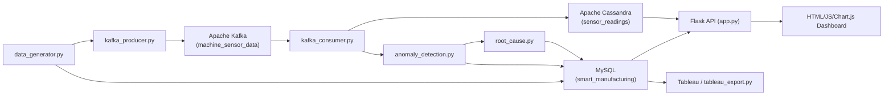
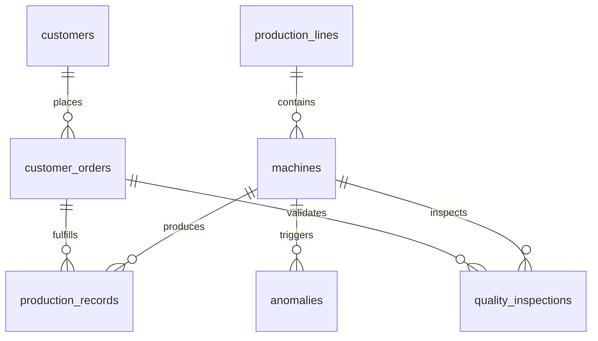

# Smart Manufacturing Quality Control & Anomaly Detection System

**Company Simulation:** Precision Manufacturing Industries  
**Category:** Academic Full-Stack Data Engineering & Industrial Monitoring Prototype

---

## 1. Project Introduction
The **Smart Manufacturing Quality Control & Anomaly Detection System** is a full-stack academic prototype that simulates a precision mechanical parts factory. It monitors 3 production lines and 5 machines, streams simulated sensor readings through **Apache Kafka**, stores time-series sensor history in **Apache Cassandra**, stores structured production, quality, and anomaly records in **MySQL**, detects abnormal machine behavior in **Python**, and visualizes live metrics through a **Flask + HTML5/CSS3/JS + Chart.js** dashboard and **Tableau** reports.

## 2. Problem Statement
Manufacturing facilities producing high-precision gears, bearings, and shafts face costly downtime and product rejections when machine parameters (temperature, vibration, hydraulic pressure, RPM) drift out of normal operating ranges. Without centralized monitoring, quality defects and equipment wear are often discovered too late.

## 3. Project Objectives
1. Simulate realistic manufacturing operations across multiple production lines, machines, and customer orders.
2. Stream real-time machine sensor readings using Apache Kafka.
3. Store high-volume time-series sensor data in Apache Cassandra and relational manufacturing records in MySQL.
4. Detect sensor anomalies using rule-based thresholds and Z-score statistics (`|Z| > 3`).
5. Provide rule-based Root Cause Analysis (RCA) and actionable recommendations.
6. Automate quality inspection against customer-specific dimensional tolerances.
7. Present live KPIs, charts, and alert management in a web dashboard and export summaries for Tableau.

## 4. Proposed Solution
A modular Python backend generates simulated facility data, streams sensor events through Kafka to Cassandra, analyzes incoming readings for anomalies and root causes, records quality inspections in MySQL, and serves a responsive 8-page web dashboard via Flask.

## 5. Technology Stack
| Technology | Role in Project |
|---|---|
| **HTML5 / CSS3 / JavaScript** | Responsive 8-page industrial dashboard UI |
| **Chart.js** | Interactive line, bar, and doughnut charts |
| **Python 3 & Flask** | Backend REST API, data generation, anomaly detection, RCA |
| **MySQL** | Relational database (`smart_manufacturing`) for machines, orders, production, quality, anomalies |
| **Apache Kafka** | Real-time sensor streaming (`machine_sensor_data` topic) |
| **Apache Cassandra** | Distributed time-series storage (`manufacturing_data.sensor_readings`) |
| **Tableau** | Executive analytics dashboards via MySQL view or CSV exports |

---

## 6. System Architecture & Data Flow

### System Architecture Diagram


### Data Flow Diagram
1. **Generate:** `data_generator.py` creates orders, production records, quality inspections, and sensor readings.
2. **Stream:** `kafka_producer.py` publishes sensor JSON every 4–5 seconds to Kafka topic `machine_sensor_data`.
3. **Consume & Store:** `kafka_consumer.py` reads messages, writes raw sensor readings to Cassandra, and calls `anomaly_detection.py`.
4. **Analyze:** Threshold rules + Z-score check flag anomalies; `root_cause.py` maps faults to simulated causes & actions; alerts are saved in MySQL.
5. **Visualize:** Flask (`/api/*`) serves MySQL & Cassandra data to the web dashboard; Tableau connects to `production_quality_summary` or exported CSVs.

---

## 7. Database Design (ER Diagram)



- **MySQL Database (`smart_manufacturing`):** `production_lines`, `machines`, `customers`, `customer_orders`, `production_records`, `quality_inspections`, `anomalies`, plus SQL view `production_quality_summary`.
- **Cassandra Keyspace (`manufacturing_data`):** Table `sensor_readings` with `PRIMARY KEY ((machine_id), timestamp) WITH CLUSTERING ORDER BY (timestamp DESC)` so each machine's readings are partitioned together and sorted newest-first.

---

## 8. Data Generation Methodology
- **Initial Dataset:** 3 production lines, 5 machines (`M001`–`M005`), 6 customers, 15 customer orders (with tolerances `±0.05`, `±0.10`, `±0.15 mm`), 500 production records, 500 quality inspection records, and 1,050 sensor readings over the past 24 hours.
- **Normal vs. Abnormal:** ~85% normal readings and ~15% abnormal readings (concentrated on fault-prone machines like `M002`, `M004`, `M005`).
- **Dashboard Controls:** *Generate Initial Data*, *Generate New Data*, and *Reset Demo Data*.

## 9. Anomaly Detection Methodology
1. **Threshold-Based Rules (`IF/ELSE`):**
   - **Temperature:** `40–80°C` Normal, `80–85°C` Medium/Warning, `>85°C` Critical.
   - **Vibration:** `0–6 mm/s` Normal, `6–7 mm/s` Medium/Warning, `>7 mm/s` Critical.
   - **Pressure:** `<4 bar` or `>9 bar` High.
   - **RPM:** Checked against each machine's configured operating range in `config.py`.
2. **Z-Score Statistical Detection:**
   - Formula: `Z = (X - Mean) / Standard Deviation`
   - Applied to Temperature and Vibration over the machine's recent 30 readings. If `|Z| > 3`, flagged as statistically unusual.

## 10. Root Cause Analysis
Predefined engineering rules map multi-sensor symptoms to simulated causes (e.g., `Temp > 85°C` & `Vibration > 7 mm/s` → *Bearing wear or friction*). All root causes are clearly labeled as simulated academic suggestions, not confirmed engineering diagnoses.

## 11. Dashboard Functionality
8 interactive pages: **Dashboard**, **Machine Monitoring**, **Production Analytics**, **Quality Inspection**, **Anomaly Detection**, **Root Cause Analysis**, **Alerts & Notifications**, and **About Project**.

---

## 12. Installation Instructions (macOS / Linux)

### 1. Python & Packages
```bash
python3 -m pip install -r requirements.txt
```

### 2. MySQL Server
```bash
# macOS (Homebrew)
brew install mysql
brew services start mysql

# Create database, tables, and Tableau view
mysql -u root < database/database.sql
```
*(Set `MYSQL_USER` / `MYSQL_PASSWORD` environment variables or update `config.py` if your MySQL root user has a password.)*

### 3. Apache Cassandra
```bash
brew install cassandra
brew services start cassandra

# Create keyspace and sensor_readings table
cqlsh -f database/cassandra_schema.cql
```

### 4. Apache Kafka
```bash
brew install kafka
brew services start zookeeper
brew services start kafka

# Create the single required topic
kafka-topics --create --topic machine_sensor_data --bootstrap-server localhost:9092 --partitions 1 --replication-factor 1
```

---

## 13. Execution Instructions (Startup Sequence)
1. Ensure **MySQL**, **Cassandra**, and **Kafka** services are running.
2. Start the Flask web application:
   ```bash
   python3 backend/app.py
   ```
3. Open `http://127.0.0.1:5000` in your browser.
4. Click **Generate Initial Data** on the top bar to populate 500 production/quality records and 1,050 sensor readings.
5. Click **Start Simulation** to stream live Kafka messages every 4–5 seconds (or run `python3 backend/kafka_consumer.py` and `python3 backend/kafka_producer.py` in separate terminals).
6. For **Tableau**, either connect Tableau Desktop directly to MySQL (`smart_manufacturing.production_quality_summary`) or export CSVs:
   ```bash
   python3 backend/tableau_export.py
   ```
   Import the generated files from `exports/` into Tableau Desktop or Tableau Public to build:
   - *Dashboard 1: Production Overview*
   - *Dashboard 2: Quality Analysis*
   - *Dashboard 3: Machine Performance*

---

## 14. Testing Scenarios
Run automated unit tests for core Python modules:
```bash
python3 -m unittest discover -s tests -v
```
Manual end-to-end checks:
- **Initial Data Generation:** Click *Generate Initial Data* → verify 5 machines, 500 production, 500 inspections, and KPIs update.
- **High Temperature / Vibration / RCA:** Start simulation → wait for periodic fault on `M002`/`M005` → verify Critical alert in MySQL and *Bearing wear* in Root Cause Analysis.
- **Alert Resolution:** Go to *Alerts & Notifications* → click *Mark Resolved* → verify status updates to `Resolved`.

## 15. Expected Outcomes
A working local prototype demonstrating end-to-end manufacturing telemetry from simulated sensor generation through Kafka streaming, Cassandra/MySQL persistence, Python anomaly detection, web visualization, and Tableau reporting.

## 16. Limitations
- Uses simulated data rather than physical PLC/IoT hardware.
- Root cause rules are static IF/ELSE heuristics rather than trained predictive maintenance models.
- Single-node local Kafka/Cassandra configuration intended for academic demonstration.

## 17. Future Enhancements
- Real OPC-UA / MQTT integration with shop-floor PLCs.
- Predictive maintenance using historical failure labeling.
- Automated email/Slack/SMS alert dispatching.

---

## 18. College Viva Preparation (32 Questions & Answers)

1. **What is the purpose of this project?**  
   To simulate and monitor a precision manufacturing plant, detect abnormal machine conditions in real time, suggest possible root causes, and track part quality.
2. **Who is the simulated company and what does it make?**  
   Precision Manufacturing Industries, producing gears, ball/roller bearings, precision shafts, and metal components across 3 production lines and 5 machines.
3. **Why is MySQL used in this project?**  
   MySQL stores structured relational data like machines, customer orders, production records, quality inspections, and anomaly alerts.
4. **Why is Apache Cassandra used instead of storing everything in MySQL?**  
   Cassandra is a NoSQL wide-column database optimized for high-volume, write-heavy time-series sensor data partitioned by machine ID.
5. **What is the difference between MySQL and Cassandra?**  
   MySQL is a relational SQL database with joins and foreign keys; Cassandra is a distributed NoSQL database designed for fast time-series writes and partition-key lookups.
6. **Explain the Cassandra primary key used in `sensor_readings`.**  
   `PRIMARY KEY ((machine_id), timestamp)` partitions data by `machine_id` and clusters rows by `timestamp DESC`, making "latest readings for a machine" very fast.
7. **What is Apache Kafka?**  
   A distributed event streaming platform used here to decouple sensor data generation from consumption and processing.
8. **What is a Kafka topic?**  
   A named channel (`machine_sensor_data`) where producers publish messages and consumers subscribe to read them.
9. **What is a Kafka producer?**  
   `kafka_producer.py`, which generates JSON sensor readings every 4–5 seconds and publishes them to `machine_sensor_data`.
10. **What is a Kafka consumer?**  
    `kafka_consumer.py`, which reads sensor messages from Kafka, stores them in Cassandra, and triggers Python anomaly detection.
11. **What is Flask and why is it used?**  
    Flask is a lightweight Python web framework that serves the HTML dashboard and provides REST API endpoints (`/api/*`) to connect the frontend to MySQL and Cassandra.
12. **Why doesn't the HTML/JavaScript frontend connect directly to MySQL or Cassandra?**  
    Browsers cannot safely connect directly to databases; keeping database logic in Flask protects credentials and centralizes business logic.
13. **How is sensor data generated?**  
    `data_generator.py` uses Python's `random` module to create ~85% normal readings and ~15% abnormal fault scenarios across 6 parameters.
14. **What 6 sensor parameters are monitored?**  
    Temperature (°C), Vibration (mm/s), Pressure (bar), RPM, Power consumption (kW), and Production speed (units/hour).
15. **What is anomaly detection?**  
    Identifying sensor readings that deviate from normal operating thresholds or historical statistical patterns.
16. **How does threshold-based anomaly detection work?**  
    It uses `IF/ELSE` rules against configurable limits (e.g., Temperature > 85°C is Critical; 80–85°C is Medium/Warning).
17. **What is a Z-score and how is it used here?**  
    `Z = (X - Mean) / Standard Deviation`. It measures how many standard deviations a reading is from the recent mean; `|Z| > 3` flags a statistical anomaly.
18. **Why avoid machine learning libraries in this prototype?**  
    Rule-based thresholds and Z-scores are transparent, fast, require no training dataset, and are easy to explain in an academic viva.
19. **How does Root Cause Analysis (RCA) work?**  
    `root_cause.py` matches combinations of abnormal sensor values (e.g., high temperature + high vibration) to predefined causes like *Bearing wear or friction*.
20. **Are the RCA outputs confirmed engineering diagnoses?**  
    No, they are simulated rule-based suggestions for academic demonstration.
21. **How does the Quality Inspection module work?**  
    Every manufactured part is checked against its customer order's dimensional tolerance (e.g., `±0.05 mm`), surface quality, and weight to assign `PASS` or `FAIL` plus a defect category.
22. **Why do different customers have different tolerances?**  
    To simulate real manufacturing where aerospace or automotive clients require tighter tolerances (`±0.05 mm`) than general industrial orders (`±0.15 mm`).
23. **What is a Primary Key?**  
    A column (like `machine_id`) that uniquely identifies each row in a database table.
24. **What is a Foreign Key?**  
    A column (like `order_id` in `production_records`) that links to a Primary Key in another table (`customer_orders`) to enforce referential integrity.
25. **How do you prevent duplicate alerts during simulation?**  
    `mysql_db.insert_anomaly` checks if an `Unresolved` alert for the same `machine_id` and `sensor_type` already exists within the last 2 minutes.
26. **What happens when a machine develops an anomaly during live simulation?**  
    Kafka delivers the reading → Cassandra stores it → `anomaly_detection.py` flags it → `root_cause.py` attaches cause/action → MySQL stores the alert and updates machine status → Dashboard updates on the next poll.
27. **How does the dashboard update during Live Simulation?**  
    JavaScript `setInterval` polls `/api/dashboard` every 4.5 seconds while simulation is active.
28. **How do you prevent multiple simulations from running at once?**  
    `kafka_producer.py` checks `is_producer_running()` before starting a new background thread, and the UI disables the *Start Simulation* button while running.
29. **Why is Tableau used alongside the web dashboard?**  
    The web dashboard handles real-time operational monitoring, while Tableau provides business intelligence reporting and multi-dimensional quality/production analytics.
30. **What is the `production_quality_summary` SQL view?**  
    A pre-joined MySQL view aggregating daily production, good parts, defective parts, and rejection rate by machine, line, and product for Tableau.
31. **What if Tableau cannot connect directly to MySQL?**  
    Running `python3 backend/tableau_export.py` exports the view and tables to CSV files in `exports/` for direct import into Tableau.
32. **How can an operator close an alert?**  
    On the *Alerts & Notifications* page, clicking *Mark Resolved* sends a POST request to `/api/resolve-alert`, updating `alert_status` to `Resolved` in MySQL.

